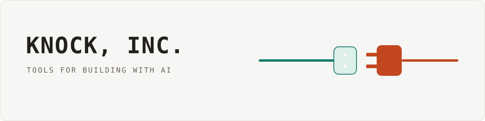

<picture>
  <source media="(prefers-color-scheme: dark)" srcset="assets/banner-dark.svg">
  
</picture>

## 差して、流して、確かめながら作る。

ノックは、AI と人が一緒に業務アプリを作るための道具を作っています。段の区切りで人が確かめる開発の流れと、それを支える Claude Code のプラグインを公開しています。

### できること

| | | |
| --- | --- | --- |
| **開発の流れを整える** | 要件 → 設計 → テスト先行 → 実装 → 検証。段ごとに止まって人が確かめます。 | [nok-pipe-in](https://github.com/nok-Inc-jp/nok-pipe-in) |
| **道具を配る** | Claude Code のプラグインを、ひとつのマーケットプレイスから入れられます。 | [nok-plugins](https://github.com/nok-Inc-jp/nok-plugins) |
| **業務アプリを作る** | 中小企業の業務アプリを、何を作るかから運用まで一緒に決めて作ります。 | |

### すぐ試す

```bash
# Claude Code で、ノックのプラグインを入れる
/plugin marketplace add nok-Inc-jp/nok-plugins
```

```bash
# pipe-in を入れて、要件メモから開発の流れを流す
git clone https://github.com/nok-Inc-jp/nok-pipe-in.git && cd nok-pipe-in
pip install -e .
pipe-in --project ~/src/myapp --text "ユーザー一覧に CSV 出力ボタンを追加したい"
```

<!-- TODO: サイト・Zenn・Qiita・note・お問い合わせ先の URL が決まったら、「書いていること」の節を足す -->

### リポジトリの状況

<sub>GitHub Actions が6時間ごとに確かめて、変わったときだけ書き換えます（[動きを見る](https://github.com/nok-Inc-jp/.github/actions/workflows/repo-status.yml)）。</sub>

<!-- repo-status:start -->
リポジトリ **3** · 開いている PR **0** · CI が失敗 **0**　<sub>表が変わった時刻 2026-11-21 23:38 JST</sub>

| リポジトリ | 最後の push | PR | Issue | CI（既定ブランチ） | 最新の版 |
| --- | --- | ---: | ---: | --- | --- |
| [.github](https://github.com/nok-Inc-jp/.github) | 2026-11-21 | 0 | 0 | — なし | — |
| [nok-plugins](https://github.com/nok-Inc-jp/nok-plugins) | 2026-11-21 | 0 | 0 | ✅ 通過 | — |
| [nok-pipe-in](https://github.com/nok-Inc-jp/nok-pipe-in)<br><sub>要件メモから 要件定義→設計→テスト先行→実装→検証 を Claude Agent SDK で流すパイプラインと、実行を図で見る VSCode 拡張</sub> | 2026-11-21 | 0 | 21 | ✅ 通過 | — |
<!-- repo-status:end -->
