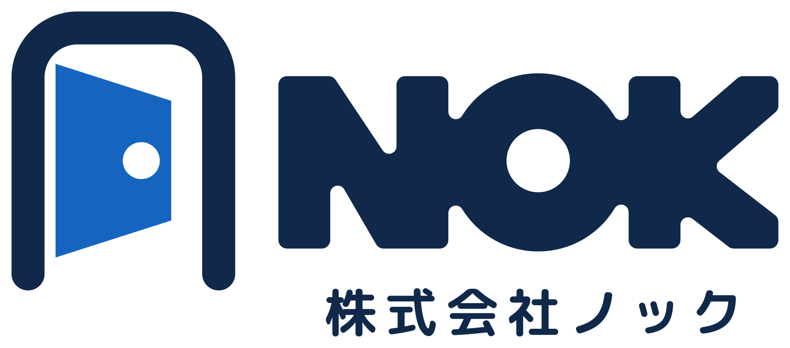
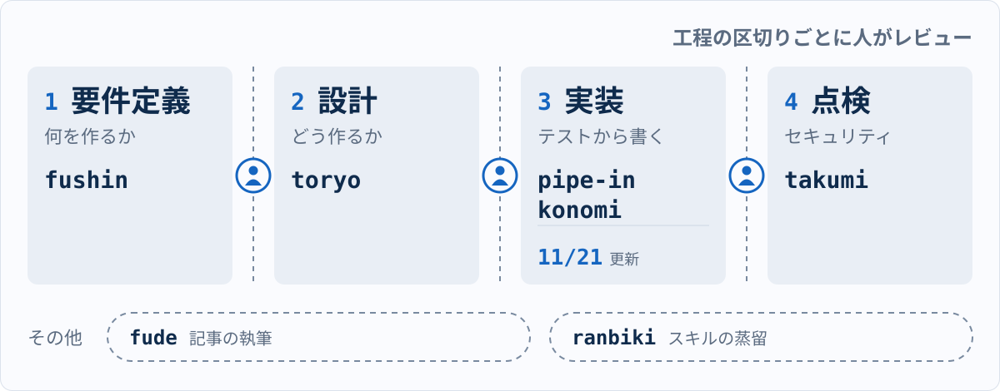
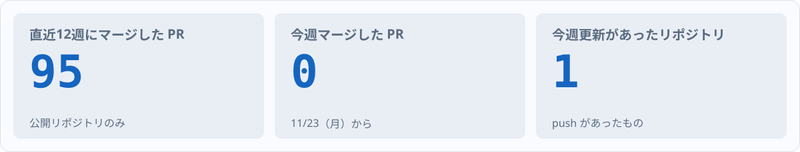
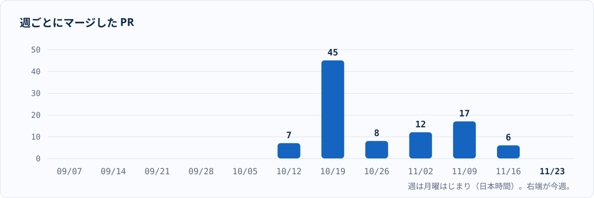

<p align="center">
  <picture>
    <source media="(prefers-color-scheme: dark)" srcset="assets/nok-signature-h-reversed.svg">
    
  </picture>
</p>

<p align="center">株式会社ノックは、北海道札幌市のソフトウェア開発会社です。<br>Web・スマホアプリ、組み込み・制御システム、AI・データ活用の開発を行っています。<br>GitHub では、AI を活用した開発を支援する自社ツールを公開しています。</p>

<p align="center">
  <a href="https://nok-inc.jp">Webサイト</a> ·
  <a href="https://github.com/nok-Inc-jp/nok-pipe-in">nok-pipe-in</a> ·
  <a href="https://github.com/nok-Inc-jp/nok-plugins">nok-plugins</a> ·
  <a href="https://nok-inc.jp/recruit">採用情報</a> ·
  <a href="https://nok-inc.jp/contact">お問い合わせ</a>
</p>

## 開発フロー

業務アプリ開発の各工程を、Claude Code のプラグインで支えています。工程の区切りごとに人がレビューし、承認してから次の工程へ進みます。

<!-- flow:start -->
<picture>
  <source media="(prefers-color-scheme: dark)" srcset="assets/flow-dark.svg">
  
</picture>

| 工程 | プラグイン | 内容 | 更新 |
| --- | --- | --- | --- |
| 要件定義 | [fushin](https://github.com/nok-Inc-jp/nok-plugins) | 業務をヒアリングし、要件シートにまとめる | — |
| 設計 | [toryo](https://github.com/nok-Inc-jp/nok-plugins) | 構成・認証・バックアップ・運用を決める | — |
| 実装 | [pipe-in](https://github.com/nok-Inc-jp/nok-pipe-in) | 要件定義から検証までを流す開発パイプライン | 11/21 |
| 実装 | [konomi](https://github.com/nok-Inc-jp/nok-plugins) | 日本語 UI のフロントエンドを一貫して作る | — |
| 点検 | [takumi](https://github.com/nok-Inc-jp/nok-plugins) | セキュリティを点検してレポートする | — |
| その他 | [fude](https://github.com/nok-Inc-jp/nok-plugins) | 原稿をサイト・Zenn・Qiita・note 向けに書き出す | — |
| その他 | [ranbiki](https://github.com/nok-Inc-jp/nok-plugins) | 上位モデルの解き方を下位モデルで再現する | — |
<!-- flow:end -->

## 開発状況

<!-- activity:start -->
<picture>
  <source media="(prefers-color-scheme: dark)" srcset="assets/stats-dark.svg">
  
</picture>
<picture>
  <source media="(prefers-color-scheme: dark)" srcset="assets/weeks-dark.svg">
  
</picture>

<sub>各リポジトリの既定ブランチにマージされた PR の数です（bot によるものを除く）。公開リポジトリのみ集計しています。最終更新 2026-11-27</sub>
<!-- activity:end -->

### 最近の更新

<!-- recent:start -->
- 11/21 · **nok-plugins** · [fushin・toryo・takumi を一覧に足す](https://github.com/nok-Inc-jp/nok-plugins/pull/7)
- 11/21 · **nok-plugins** · [雛形を公式ディレクトリの基準に合わせ、雛形との差を見る道具を足す](https://github.com/nok-Inc-jp/nok-plugins/pull/5)
- 11/20 · **nok-pipe-in** · [antenna の回が、公式の文書が根拠の小さな変更だけを自分で main に入れる（D0101）](https://github.com/nok-Inc-jp/nok-pipe-in/pull/158)
- 11/16 · **nok-plugins** · [fude（記事を書くプラグイン）を足す](https://github.com/nok-Inc-jp/nok-plugins/pull/4)
- 11/14 · **nok-pipe-in** · [プラグインの eval の採点の取りこぼしを直し、見本と残した記録への当て直しと haiku のラウンドで確かめる（D…](https://github.com/nok-Inc-jp/nok-pipe-in/pull/154)
<!-- recent:end -->

## クイックスタート

<details>
<summary>Claude Code にプラグインを追加する</summary>

```bash
/plugin marketplace add nok-Inc-jp/nok-plugins
/plugin install pipe-in@nok-plugins
```

</details>

<details>
<summary>pipe-in で開発パイプラインを動かす</summary>

```bash
git clone https://github.com/nok-Inc-jp/nok-pipe-in.git && cd nok-pipe-in
pip install -e .
pipe-in --project ~/src/myapp --text "ユーザー一覧に CSV 出力ボタンを追加したい"
```

</details>

<sub>このページの図と数字は、GitHub Actions が6時間ごとに更新しています（[実行履歴](https://github.com/nok-Inc-jp/.github/actions/workflows/update-profile.yml)）。</sub>
